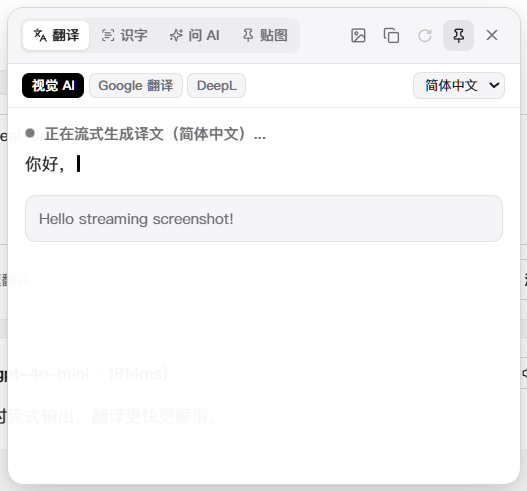
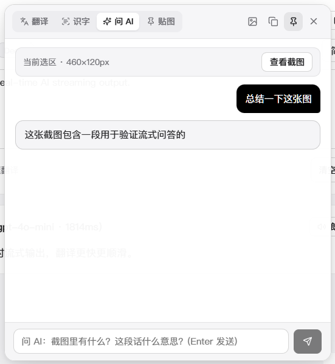

# Luma

轻量级 Windows 桌面快捷截图、原位翻译、OCR 识字、桌面贴图与 AI 视觉效率工具，基于 **Tauri v2 + Rust + React** 构建。

按下全局快捷键即可冻结屏幕框选区域，一步完成识字、翻译、原位覆盖预览、看图问答、拼图或置顶贴图；全面支持 **AI 实时流式输出（SSE）**、**HTTP / SOCKS5H 网络代理** 与 **应用内带实时进度条的签名自动更新**，常驻系统托盘，随叫随到。

> 👉 **[前往 Releases 下载最新安装包](https://github.com/Leon-Ma857/Leon-/releases/latest)**

---

## 界面预览

| 截图实时流式翻译 | 选区多轮流式「问 AI」 |
| :---: | :---: |
|  |  |

---

## 核心功能

### 1. 截屏翻译、原位覆盖与实时流式输出
- **微信式冻结选区**：默认全局快捷键 `Alt+Q`（支持按键录制自定义），支持多显示器与 HiDPI 缩放。
- **原位沉浸翻译**：框选后按 `Tab` 直接在选区原位擦除原文并覆盖显示译文，自适应背景色与高对比度文字；支持一键复制、保存或贴图译文图。
- **AI 全链路实时流式输出（SSE）**：文本翻译台、结果浮窗（翻译 / OCR / 问 AI）、截图选区侧栏与悬浮叠堆批量处理均支持逐字流式渲染，首字响应更快、无需干等；不支持流式的接口会自动无感回退。
- **多引擎自由切换**：
  - **视觉 AI（推荐）**：一步看图识字并自然意译，内置 OpenAI、通义千问（Qwen-VL）、硅基流动、智谱（GLM-4V）、Google Gemini、本地 Ollama 等 OpenAI 兼容接口预设。
  - **Google 翻译 / DeepL**：本地 Windows OCR 提取文字后调用翻译引擎，支持中英混排与代码下划线精准还原。
- **自定义术语表与提示词**：支持配置专有名词对照表（Glossary）与提示词预设，统一技术文档与专业词汇译法。

### 2. 全能截图标注与实用工具
- **标注工具**：矩形、椭圆、箭头、画笔、隐私马赛克、文字标注，支持多区域加选批量处理。
- **像素级精准操作**：23×23 实时放大镜与坐标 / `#HEX` 取色器（未框选时按 `C` 复制色值），选区支持方向键 `1px` 微调与 `Shift+方向键` 调尺寸。
- **更多快捷工具**：支持**滚动长截图**自动拼接、**选区二维码识别**、**剪贴板图片直译/识字**、**剪贴板文字速译**。

### 3. 悬浮叠堆工作台与桌面贴图
- **悬浮叠堆**：连续框选多张截图收入右下角叠堆，支持一键**竖排 / 横排 / 宫格拼图**、**批量流式翻译**、**批量识字**、**多图联合问 AI**，并可将结果导出为 Markdown 笔记。
- **桌面贴图**：任意截图或原位译文图可一键置顶贴在桌面，支持滚轮缩放、90° 旋转、水平镜像翻转、透明度调节与一键复位。

### 4. 网络代理、历史管理与签名自动更新
- **网络代理与自定义更新源**：内置 HTTP / HTTPS / SOCKS5 / SOCKS5H 代理支持（提供 Clash / v2rayN 一键预设，自动豁免 `localhost` / `127.0.0.1` 本地 Ollama 直连）、自定义 HTTPS 更新源镜像与一键连通性测试。
- **悬浮译文卡片 & 历史管理**：支持置顶锁定、智能合并 PDF/分栏多余换行、在线编辑原文重译、复制双语与语音朗读；内置纯文本翻译台，自动保存最近 100 条记录，支持搜索筛选、浮窗重开及 Markdown / JSON 导出。
- **应用内更新弹窗 & 自动检查**：支持浅色 / 深色 / 跟随系统主题、开机自启、配置导入导出（自动排除 API Key）。启动及驻留托盘期间定时自动检查更新，应用内弹窗展示更新说明与流式实时下载进度条，安装前强制校验 Tauri 更新公钥签名并拒绝降级。

---

## 下载与安装

仅支持 **Windows 10 / 11 (x64)**：

1. 打开 [Releases 页面](https://github.com/Leon-Ma857/Leon-/releases/latest)，下载最新的 `Luma_<版本>_x64-setup.exe`。
2. 运行安装程序完成安装，从开始菜单启动 **Luma**（若系统缺少 Microsoft Edge WebView2 Runtime，安装程序会自动引导安装）。
3. **关于 Windows SmartScreen 提示**：由于个人分发版本尚未附加商业代码签名证书，首次运行安装包时可能出现“Windows 已保护你的电脑”提示，点击 **「更多信息」→「仍要运行」** 即可。应用内在线更新独立使用内置 Tauri 公钥校验签名完整性。

### 更新说明
- **`0.7.24` 及以上版本**：支持应用内更新弹窗、实时下载进度条、自定义 HTTP/SOCKS5H 代理与更新源镜像；启动及驻留托盘期间定时自动检查更新，发现新版后通过 Windows 通知、托盘菜单和设置页提醒，确认后自动校验签名并安装。
- **`0.7.23` 版本**：支持后台自动检查与系统通知，点击更新即可自动升级到最新版。
- **`0.7.22` 及更早版本**：请在设置页或托盘菜单手动点击一次「检查更新」，或直接下载最新安装包覆盖安装，原有的配置与历史记录会自动保留。

---

## 快速上手

1. **配置翻译引擎**：首次打开 Luma 进入设置页，在「视觉大模型接口」选择一个预设（例如智谱 `glm-4v-flash`、通义千问 `qwen-vl-plus`、硅基流动、OpenAI 或本地 Ollama），填写 API Key 后点击 **测试连接** 并 **保存设置**。
2. **（可选）配置网络代理**：若所在网络访问 GitHub 更新源或海外 API 不畅，可在「网络代理与更新源」填入代理地址（如 Clash `http://127.0.0.1:7890` 或 v2rayN `socks5h://127.0.0.1:10808`）并点击一键测试。
3. **开始截图**：按下 `Alt+Q`，拖拽框选屏幕任意区域。
4. **快捷操作**：按 `Tab` 原位预览译文，按 `T` 或 `Enter` 打开侧栏译文，或按工具栏按钮识字、问 AI、贴图、入叠堆。关闭主窗口后 Luma 会最小化到系统托盘继续待命。

---

## 常用快捷键

### 全局快捷键
| 快捷键 | 功能 |
| --- | --- |
| `Alt+Q` | 冻结屏幕开始截图（可在设置页自定义） |
| 自定义 | 剪贴板文字速译（在设置页录制启用） |

### 截图选区界面
| 按键 | 功能 |
| --- | --- |
| `Tab` | 原位译文覆盖预览切换 |
| `T` / `Enter` | 原位翻译选区并打开侧栏 |
| `O` | 识别选区文字（OCR） |
| `A` | 针对选区截图向 AI 提问 |
| `Q` | 识别选区二维码 |
| `B` | 将当前选区收入右下角叠堆 |
| `P` | 将当前选区贴图置顶桌面 |
| `C` | 复制选区截图（未框选时复制鼠标处 `#HEX` 色值） |
| `Space` | 叠堆已有截图时收入叠堆；叠堆为空时复制选区并退出 |
| `方向键` / `Shift+方向键` | `1px` 微调选区位置 / 尺寸 |
| `Esc` | 收起面板或退出截图 |

---

## 常见问题

**Q：视觉 AI 模型和 Google / DeepL 有什么区别？**  
使用视觉大模型（如 `qwen-vl-plus`、`glm-4v-flash`、`gpt-4o-mini`、`gemini-2.5-flash`）可直接看图完成识字与翻译，复杂排版、代码和中英混排准确度更高；使用纯文本模型、Google 或 DeepL 时，会先通过 Windows 本地 OCR 提字再翻译。

**Q：配置了代理之后，本地 Ollama 还能正常直连吗？**  
可以。Luma 的 HTTP 客户端自动对 `localhost` 和 `127.0.0.1` 豁免代理直连，配置 Clash / v2rayN 代理后不会影响本地 Ollama 服务。

**Q：配置和历史记录保存在哪里？重装会丢失吗？**  
保存在本机 `%APPDATA%\com.snaptrans.app`。覆盖安装或应用内更新不会清除配置和历史记录。你也可以随时在设置页导出配置备份（导出文件自动不包含 API Key）。

**Q：如何反馈问题或提需求？**  
欢迎在 [Issues](https://github.com/Leon-Ma857/Leon-/issues) 提交使用反馈、Bug 报告或功能建议。
